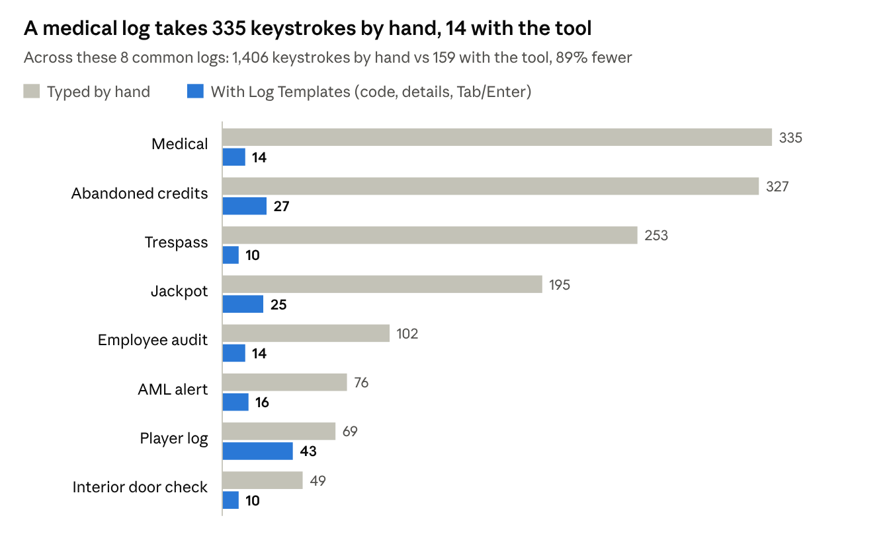

# Watchlog

Oct 31, 2026 · Jakob

## Summary

I'm asking for approval for Watchlog, a tool I built to speed up our log entries, so that anyone on the team who wants it can use it. I'd like IT to look it over first.

Every shift is typing the same entries: door checks, audits, jackpots, refusals, soft count steps, AML alerts. Each one has standard wording and a few details that change. Watchlog keeps the standard wording ready. You type a short code, fill in the details, and the finished entry goes into iTrak. You still read it over and save it yourself, same as now.

It also takes care of the repetitive clicking around the logging. One key clears the Alert Grid list, and the start of shift opens and signs into our programs.

By my count it saves about 2,000 keystrokes and around 14 minutes a shift on typing and opening programs, or roughly 42 hours a year per operator. Clearing Alert Grid alerts with one key should add another 5 to 10 minutes a shift. These are estimates. The tool now counts its own savings, and I plan to count one full shift by hand to check them. The time saved goes back into watching the floor.

| What I type | What ends up in the log |
| --- | --- |
| `;interior` (9 keystrokes) | Security Supervisor performed interior door check |
| `;evict`, check the 3 boxes, Enter (9 keystrokes if the defaults are right) | Report opened on behalf of Security. The Security Supervisor approached a guest at Main Entrance for showing signs of intoxication. The guest was escorted off the gaming floor and given a 24 hour Trespass. The guest left without further incident. |

<!-- fig: image2.png 2.4, image3.png 3.5 | I type ;evict, check the three boxes and press Enter. The entry goes into the Synopsis box in iTrak, and I read it over and save it myself. -->

What I'd need:

- The supervisors, picked by management, to approve the template wording. The shared file would sit in a SharePoint folder that all of them have access to.
- IT to look at how passwords are stored, the automatic logins, the Alert Grid clicks, running Watchlog.exe and starting it with Windows, and the shift journal (a copy of each entry kept for 30 days).

There's no separate pilot. Our room has 3 operator bays and a supervisor bay, and if it's approved, whoever wants to use it can.

Security has its own section further down. In short: passwords are kept in Windows Credential Manager and never in a file, the tool doesn't connect to the internet or send anything anywhere, and a built-in report shows exactly what it has saved on any PC.

## What it does

It's a small Windows program. It's written in AutoHotkey, a free automation tool that has been around for years, and comes as a single Watchlog.exe with everything built in, so nothing else needs installing. It sits by the clock as a small teal icon and starts with Windows. I've been building and testing it myself since October 13. Version 3.0 was the first one set up for the team, and it's on 3.29.1 now.

<!-- fig: image4.png 1.7 | The Watchlog icon sits by the clock. Right-clicking it opens this menu. -->

### Log entries

There are 36 templates so far. Every code starts with a semicolon so it never goes off in the middle of normal typing, and the entry appears as soon as the code is typed. Anyone who uses the semicolon for something else can pick a different symbol for their own PC in Settings.

| Area | Codes |
| --- | --- |
| Incidents and reviews | `;jack` jackpot · `;audit` employee audit · `;medical` · `;evict` trespass · `;face` facial recognition alert |
| Start and end of shift | `;start` · `;end` (remembers which bay you were on last) · `;break` (also keeps count of the 60 minutes of break) |
| Security routines | `;interior` · `;exterior` door checks · `;parking` patrol · `;refuse` refused entry (one or several patrons) · `;selfex` self-exclusion · `;inventory` · `;account` review · `;drop` table drop · `;man` garbage sweep |
| Tables | `;open` · `;close` · `;auto` auto-close · `;cards` card change · `;fill` table fill · `;player` player log |
| Slots | `;bv` emergency BV pull · `;abandon` abandoned credits returned · `;found` abandoned credits taken to Security · `;aml` AML alert · `;maint` maintenance · `;mfill` ATM and NRT fill · `;firm` NRT firmware check |
| Soft count | `;countstep` step by step · `;counttables` · `;countslots` · `;countpull` |
| Other | `;destroy` card destruction · `;badge` contractor pass or interview pass |

If you can't remember a code, Ctrl+Alt+Space opens a search. Type a word like trespass or ambulance, look at the wording, and press Enter. Ctrl+Alt+H brings up a cheat sheet with every code on it.

<!-- fig: image5.png 3.5, image6.png 2.4 | Ctrl+Alt+Space finds a template by any word, and Ctrl+Alt+H shows every code. I covered my login names on the cheat sheet. -->

### Forms for the details

When an entry has details that change, a small form pops up with a box for each one. Tab moves between boxes, Enter puts the entry in and Esc cancels. The form takes care of the fiddly parts:

- Times fill themselves in (audits get the time plus 20 minutes), and typing 2130 gives 21:30.
- Money and percentages come out formatted, so 10000 becomes $10,000 and 67 becomes 67%.
- The medical outcome, trespass reason and length, employee job title and table number are picked from a list instead of typed. Typing 202 picks FB202, and typing the first letters of a choice finishes it.
- Machine numbers come out in capitals, and an employee number you've just copied fills itself in.
- For a facial recognition alert, I copy the alert number and the match percentage from the facial rec page in Edge, and `;face` fills both in. It warns me if the alert number is the same as or lower than the last one I logged, since they always go up.
- A BV pull, table fill or machine fill can list several machines or tables in one entry.
- An empty box leaves XXXXX in the entry, so a missing detail is easy to spot. A preview at the bottom of the form shows the finished entry as you type.

<!-- fig: image7.png 2.9, image8.png 2.9 | The audit form with its preview, and a list that's picked instead of typed. -->

<!-- fig: image9.png 2.9, image10.png 2.9 | A BV pull and a machine fill with several lines in one entry. Add another (Ctrl+Enter) keeps the earlier ones in the preview. -->

### Filling in the whole daily log

Most codes can now do the whole iTrak entry, not just the wording. `;cards`, for example, opens a new daily log in iTrak (or uses the one already open), picks the Location, Topic and Reference, and puts the wording in the Synopsis. Seventeen codes work this way so far, including the door checks, patrols, table fills and openings, jackpots, BV pulls and machine fills. Where the Reference is a number I look up, it's left empty for me to fill in.

Most of these entries start as a phone call. The call pad (the + key on the number pad) is a small box I jot the call into. If I write it in shorthand, like `fill 205 5.5` for a $5,500 fill on table 205, Ctrl+Enter turns it straight into the finished daily log. Ctrl+Alt+F opens a short list of logs that never change, like Break or Table Drop, and Ctrl+Alt+Shift+R repeats the last one.

Each PC is taught once where the New daily log button and the boxes are, the same way as Alert Grid. Watchlog never clicks Save. I still read the entry over and save it myself.

### Clearing Alert Grid

Most Alert Grid alerts need nothing from us, but each one still has to be acknowledged. By hand that's Ctrl+A on the list, right-click, Acknowledge as received, Submit, then OK, and I do it about 50 to 80 times a shift.

With Watchlog I look over the list first, then press Caps Lock (or Ctrl+Alt+A). It brings Alert Grid to the front, does those same clicks, clears the acknowledged alerts, answers the "no more alerts" step, and puts me back in the window I was in. If alerts that were already acknowledged are still in the list (Alert Grid won't acknowledge those again), it clears them first and then does the rest. It works from any window. It clears everything in the list, so the operator still checks the alerts by eye before pressing the key, same as now.

The Acknowledge box already has the operator's own Alert Grid login filled in by Alert Grid itself. Watchlog never reads or types that password, it only clicks Submit. Each PC is taught where to click once: the operator clears alerts by hand one time and presses F8 over each spot (Ctrl+Alt+Shift+A starts it). Only those screen positions are saved, on that PC.

### Logging in

- A short code types the username and password and presses Enter. Each login is locked to the programs it belongs to, so the code does nothing anywhere else.
- When Ctrl+Alt+S or Ctrl+Alt+C brings SDS or CMP to the front, Watchlog asks "Log in to SDS as …?". Enter types the login, Esc or waiting 6 seconds says no.
- At the start of shift it asks once whether to sign into the programs it just opened. On yes, it brings each one to the front and types its login.
- SDS logs me out an hour after I sign in, so Watchlog signs it back in by itself. 62 minutes after an SDS login it checks that SDS is really on its login screen, types the saved login, and puts me back in the window I was in. If SDS still says Welcome it tries again every minute, up to 6 times. It never types unless it sees the login screen, and Settings > Logins can turn it off. Other logins that expire still get a quiet pop-up reminder, with the beep off unless you turn it on in Settings.

### Finding your way around

Clicking the Watchlog icon (or Ctrl+Alt+M) opens a home window with a button for every feature, grouped as Logs, Logins and Set up. Each button shows its shortcut, so new operators learn the keys as they go. A strip along the bottom shows the version, whether the templates are current, whether Alert Grid is taught on this PC, how much break time is left and the time saved this shift. Right-clicking the icon gives the same things as a menu with small pictures, and the less-used items are tucked into Alert Grid, Windows and Advanced sub-menus.

Settings is now a window with tabs (Logins, Templates, Start / end of shift, Alert Grid, Updates, General), so nothing needs editing in settings.ini by hand. Ctrl+Alt+E opens a template editor for whoever looks after the wording. It lists the templates, shows the finished entry as you change it, flags clashes, and keeps a backup before saving. Saving the team's file asks first, because it changes every bay. Editing in Notepad still works under Advanced.

### Everything around the logging

- `;t`, `;dd` and `;dt` type the time, the date, or both.
- Break time: we get 60 minutes a shift, split however we like. Watchlog starts counting when `;break` fills the break log and stops when I save and close it, and shows the minutes left on the home window, the dashboard and the tray icon. It starts over at the next start of shift.
- Ctrl+Alt+Shift+D opens a shift dashboard: logs by type, Alert Grid clears and time saved for this shift, the last 7 days and the last 30.
- Backups: the first time Watchlog starts each day, it copies the operator's templates, settings and taught click spots (never passwords) to a backup folder on that PC and keeps the last 14. Any of them can be put back from the tray menu, and the previous version of Watchlog itself can be put back the same way.
- Ctrl+Alt+L opens everything for the start of shift in about 20 seconds: SDS, Alert Grid and CMP first, then the iTrak facial recognition and the Citrix page in Edge, skipping anything that's already open. It offers the sign-in above, puts the windows back where I like them, and ends with Edge on the Citrix page ready to start iTrak.
- Ctrl+Alt+Shift+L closes it all at the end of the shift, after confirming. It logs out of SDS properly first instead of just closing it, and Ctrl+Alt+K does that SDS logout on its own.
- Window layout: Ctrl+Alt+Shift+S saves where every window is and Ctrl+Alt+W puts them back. The start of shift does this by itself.
- Caps Lock guard: plain Caps Lock can't turn caps on by accident (Shift+Caps Lock does), and a red CAPS LOCK ON tag shows while it's on. That's what frees the Caps Lock key to clear Alert Grid. There are no beeps, so it doesn't bother anyone nearby.
- Ctrl+Alt and a letter switches to SDS, CMP, Teams, Outlook or Edge.
- Ctrl+Alt+Q adds a quick note, with a tag like #todo if you want one. Ctrl+Alt+O shows all the notes in a window that always reads the latest copy, so an old Notepad tab can't save over newer notes.
- The shift journal saves a copy of every entry you put in, with the time. Ctrl+Alt+J shows how many of each log you've done and gives you a one-line summary for the End of Shift entry, like "Shift summary (18:20 - 05:47): 47 logs. 12 Audit, ...". If iTrak loses an entry, you can copy it back from the journal.

<!-- fig: image11.png 2.9, image12.png 3.0 | End of shift asks first, then logs out of SDS and closes the work apps. The shift journal counts the logs and shows the time saved so far. -->

<!-- fig: image13.png 2.9 | Ctrl+Alt+Q opens a quick note. -->

### Using it as a team

Everyone reads the same template file from a SharePoint folder, so the whole team writes from the same approved wording. When the supervisors change something, every bay picks it up as SharePoint syncs, without restarting anything. If SharePoint can't be reached, the tool keeps using the last copy it had and says so. Each PC also checks that it's on the same version as the rest of the team, and says if it needs an update. When a new Watchlog.exe is put in the shared folder, each PC asks before updating itself, checks that the new file works, and keeps a backup of the old one, which can be put back from the tray menu. I can also point my own PC at a separate folder, so I can try a new version on my bay before anyone else gets it.

Setting up a new operator takes about 5 minutes. They run Watchlog.exe and say yes to installing it. That only puts it in their own Windows profile, with no administrator rights, adds it to the Start menu and starts it with Windows. It can be removed in Settings > Apps like any program. A short tutorial shows how codes, forms and the search work, with practice boxes, and a welcome window asks for their logins and where the team file is. After that, changes are made in a Settings window rather than by editing files, and there's a one-page quick start guide. Operators can add a few codes of their own in a separate file, but those can't override a team template.

<!-- fig: image15.png 3.6 | The Settings window, where logins, the team templates file and the journal are set up. I covered the usernames. -->

## Why it helps

- It's faster. A typical entry takes 5 to 25 keystrokes instead of 50 to 300 or more, and clearing Alert Grid is one key instead of five steps.
- Entries are more consistent. When everyone works from the same file, entries read the same no matter who wrote them, which should make reviews and audits easier.
- There are fewer mistakes. Times come from the PC clock, numbers are formatted the same way every time, and the standard wording can't pick up typos. It won't stop someone saving an incomplete entry, but the XXXXX makes it hard to miss.
- Training is easier. New operators get a tutorial, can find a template by any word in it, and the templates show how each kind of entry should be worded.
- It's easier on the hands and on concentration over a long shift.
- It's easy to keep up to date. If a procedure changes, one edit to the shared file updates every bay.

It works in anything you can type into, including iTrak through Citrix, because all it does is paste text where the cursor is. Other departments that write repetitive reports, like security or the cage, could use it with their own template file.

## Time saved (my estimates)

I worked these out by counting the keystrokes for each template, typed in full versus with the tool, over a typical shift. They haven't been timed yet.

{width=6in}

The longer the entry, the more it saves. The player log saves the least because most of it is details you still have to type.

### A typical shift

| Task | Per shift | By hand | With the tool | Saved |
| --- | --- | --- | --- | --- |
| Log entries (a mix of 18 templates) | 30 entries | 2,207 keystrokes | 388 keystrokes | 1,819 |
| Logins (one app every hour) | 10 logins | about 240 keystrokes | about 50 keystrokes | about 190 |
| Time stamps | 10 stamps | 60 keystrokes | 20 keystrokes | 40 |
| **Total typing** | | **about 2,500** | **about 460** | **about 2,050 (82% less)** |
| Opening apps and sites at start of shift | 3 apps, 2 web pages | about 3 minutes | 1 key, about 20 seconds | about 3 min |
| Closing everything at end of shift | about 11 programs | about 1 minute | 1 key and a confirm | about 1 min |

That's about 14 minutes a shift: around 10 minutes of typing at 40 words a minute, plus about 4 minutes of opening and closing apps.

| Period | Keystrokes saved | Time saved |
| --- | --- | --- |
| Per shift | about 2,050 | about 14 minutes |
| Per month (15 shifts) | about 31,000 | about 3.5 hours |
| Per year (180 shifts) | about 369,000 | about 42 hours |
| A team of 6 operators, per year | about 2.2 million | about 250 hours |

Alert Grid isn't in those tables. I clear it about 50 to 80 times a shift, and each clear by hand is five steps that take me roughly 5 to 10 seconds. One key instead should save somewhere around 5 to 10 minutes a shift, which would nearly double the total. I haven't timed this yet either.

How I got these numbers:

- The shift I counted has 30 entries: start and end of shift, 2 each of door checks, patrols, jackpots, AML alerts, facial recognition alerts, no-ID refusals, account reviews and card changes, 4 audits, and 1 each of a table drop, table close, table fill, player log, medical and BV pull. A busier shift would save more.
- "By hand" means typing the whole entry. "With the tool" means the code, only the details that change, and a Tab or Enter for each box.
- I counted on an earlier version (2.4). Codes no longer need a space after them, and `;face` now fills itself in from a copy, so the real numbers are a little better.
- I didn't count fixing typos, looking up wording, redoing entries that get sent back, or logging back in after a missed hourly login. Those would only add to it.
- The team row assumes 6 operators doing the same mix of entries.

It could look better than it really is for anyone who already copies and pastes from old entries, and worse for anyone who looks up wording or fixes a lot of typos. I plan to spend one shift counting exactly how many times each thing is done, which will give better numbers than these.

### Tracking it for real

The tool keeps its own count, so these estimates can be replaced with real numbers. For each entry it works out how much went in compared with how much I typed. An empty box counts as nothing saved, so the numbers aren't inflated. Logins and time stamps are counted too, and each Alert Grid clear counts as 3 keystrokes, which is on the low side. The time comes from 40 words a minute. Tray menu > Time saved shows logs, logins, keystrokes and time saved for this shift, today, the last 7 days, the last 30 days and the total, and Copy report puts it on the clipboard. It only stores numbers, never the text of a log.

<!-- fig: image16.png 4.2 | The time saved so far this shift, shown at the top of the shift journal. Tray menu > Time saved has the full breakdown. -->

## Security and saved information

Since security comes first here, this is everything the tool saves and where. It doesn't save anything else.

| What | Where it's kept | Who can see it | How long |
| --- | --- | --- | --- |
| Passwords | Windows Credential Manager on that PC, where Windows keeps its own saved passwords | Only that Windows user. Never put in a file, synced or shown on screen | Until the login is removed in Settings, which deletes the password too |
| Login codes, usernames and settings | settings.ini in the operator's Documents\\Watchlog folder | The operator | Until changed. There are no passwords in it. If someone types one in, the tool moves it into Credential Manager the next time it starts |
| Shift journal (time, template and text of each entry, never logins) | The operator's Documents\\Shift Journal folder, which syncs to their own OneDrive | The operator | 30 days, then deleted automatically. It can be set anywhere from 7 days to a year, set to keep only times and template names, or turned off |
| Quick notes | Quick Notes.md in the operator's Documents | The operator | Until they delete them |
| Alert Grid and iTrak click spots | That PC only | That Windows user | Screen positions only. Until the PC is taught again |
| Daily backups of templates, settings and click spots | That PC only (the user's AppData) | That Windows user | Never passwords. The last 14 days |
| Break time used this shift | That PC only | That Windows user | Minutes only. Starts over each shift |
| Window layout | That PC only | That Windows user | Program names, window positions and sizes only. Until saved again |
| Time saved counts | That PC only | That Windows user | Numbers only, never log text |
| The last value of a few boxes, like the bay and the last facial rec alert number logged | That PC only | That Windows user | Until the next one replaces it |
| Activity log (when the tool started, settings changes, template updates, which login was used, Alert Grid clears, errors) | That PC only | That Windows user | Trimmed automatically. Never passwords or log text |
| Last login time for each username | The Windows registry, under the user's own settings | That Windows user | Only used for the hourly reminder |
| A facial rec alert number or match % just copied in Edge | Memory only, never saved | Nobody | Forgotten after 2 minutes or once used |
| Template wording | One file in a SharePoint folder, plus a backup copy on each PC | Whoever the folder is shared with. Only the people management allows can edit it | SharePoint keeps earlier versions and who changed them |

A few more things worth knowing:

- It doesn't connect to the internet or send anything anywhere. Its files only reach another PC through the operator's own OneDrive and SharePoint, under our normal Microsoft 365 permissions. (Ctrl+Alt+L opens the work websites in the browser, the same as clicking a bookmark.)
- It doesn't record what you type. It only watches for its own codes.
- It only types a password when that login's code is typed, when the operator says yes to "Log in?" or to the start of shift sign-in, or when SDS comes back to its login screen after an SDS login the operator did. That last one can be turned off in Settings. Every time, it checks right before typing that the program in front is one that login is locked to. A login that isn't locked to a program is never typed automatically.
- In Alert Grid it only clicks and presses Ctrl+A, Enter or Esc. It never types into the Acknowledge box.
- In iTrak it only clicks New daily log, the Location, Topic, Reference and Synopsis boxes and End Time's Now button, and types or pastes the entry into them. It never clicks Save.
- It only looks at the clipboard when a form opens with a box that takes a copy, and for `;face` it notices copies made in Edge. Nothing it sees there is saved to a file.
- It doesn't change iTrak or any other system. It types or clicks what the operator would have, and the operator still saves the entry.
- The copy it makes for sharing never includes anyone's settings, passwords, journal or notes.

And how to check all of this:

- Security and status, in the tray menu, shows everything above for the PC you're on: which logins have a saved password and which program each one is locked to, whether a password has ended up in settings.ini, where the templates came from, the journal setting, and how many shift files there are. The Copy report button puts it on the clipboard so it can be sent to a supervisor or IT.
- Each PC shows a short check code for its template wording, something like 1A2B-3C4D. Two PCs with the same code have exactly the same wording, so it's easy to confirm every bay is on the approved version.
- When the shared wording changes, each PC shows a notice and writes the old and new check codes to its activity log.

<!-- fig: image14.png 5.4 | Security and status for the PC I'm on. I covered my username and PC name. -->

## Setup and what IT would need to look at

Watchlog.exe installs per Windows user, with no administrator rights, into that user's AppData. It adds a Start menu entry, a shortcut in the user's Startup folder and an entry under Settings > Apps for removing it. Settings and templates go in the user's Documents\\Watchlog folder, which OneDrive syncs, so they follow the operator from bay to bay. The template wording comes from the shared file.

The exe isn't signed, so Windows may show a SmartScreen warning the first time. For IT, I also have the plain script version (Watchlog.ahk), which is the same program as one text file anyone can read.

| File | What it is |
| --- | --- |
| Watchlog.exe | The program |
| templates.txt | The wording of every template, in plain English. The team copy lives on SharePoint and the supervisors look after it |
| my-templates.txt | Optional extra codes for one operator, kept separate from the approved wording |
| settings.ini | That operator's login codes and usernames (no passwords), which program each login is locked to, app shortcuts and start and end of shift lists. Created by the welcome window |
| LaunchWork.bat | Opens the iTrak facial recognition and Citrix pages in Edge, for double-clicking. The start of shift opens them itself |
| QUICK START.txt and README.txt | A one-page setup guide and the full guide |

What IT would need to approve:

- Running Watchlog.exe from the user's own profile and starting it with Windows
- Storing passwords in Windows Credential Manager and having the tool type them into the programs they're locked to
- The tool clicking through the Alert Grid acknowledge steps for the operator
- The tool opening a new iTrak daily log and filling in its boxes, which the operator then reads over and saves
- Signing back into SDS by itself about an hour after the operator's own SDS login, only when SDS is on its login screen
- The shift journal keeping a copy of log text for 30 days
- Who gets edit access to the SharePoint template folder. A new Watchlog.exe put there updates every PC that says yes, so I'd keep it to the supervisors and me

## Next steps

Version 3.29.1 is built and I've been using it on my own shifts. If it's approved, this is how I'd see it going:

1. Management and IT sign off.
2. The supervisors go through and approve the wording of each template.
3. The approved file goes in a SharePoint folder that all the supervisors have access to.
4. I count one full shift by hand to check the time saved numbers.
5. Anyone on the team who wants it installs it on their bays.

I'm happy to show it working to anyone who'd like to see it.
